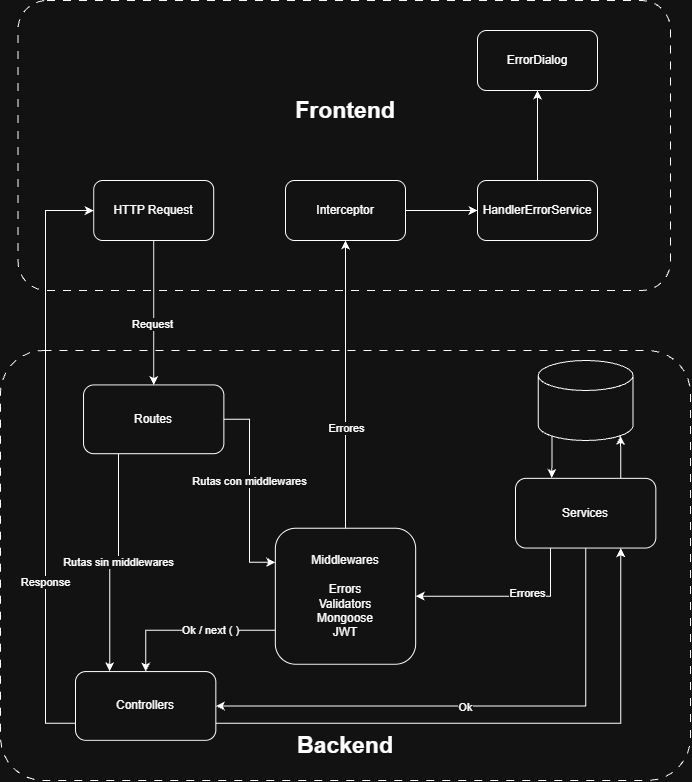

# Diplomatura en Profesional Full-Stack Developer

## Curso de desarrollo con Node JS - Profesor: Gabriel Alberini

### Módulo 1: Node JS

### Trabajo Final Integrador

### Desarrollo en Node JS

### Objetivos:

Construir una API RESTful CON Node.js, Express y MongoDB que sirva como backend para una aplicación de chat (o similar), integrando la lógica del servidor con persistencia de datos en base de datos.

### Consideraciones del backend:

No se pretende desarrollar una aplicación completa, sino establecer algunas funcionalidades que se aprendieron durante el curso y a los fines de cumplir con las consignas de la tarea.<br>

- Se establece una organización de archivos por funcionalidad o dominio de negocio. Las funcionalidades son las de productos, usuarios y carrito.<br>

- Se genera una conexion con una base de datos MongoDB.<br>

- En el esquema del carrito no se repiten los datos del producto, sino que se crea una relación entre el carrito y los productos cargados y entre el carrito y el usuario. De esta forma existirá una relación uno a uno entre el carrito y el usuario.<br>

- Las imagenes de los productos se mantienen como datos estàticos a los fines de simplificar el proyecto. En caso que se quiera cargar imagenes de forma dinámica es conveniente guardar esas imagenes en un servidor como por ejemplo **Cloudinary**.<br>

- Se realiza el despliegue para producción en Render. En Render se configuran las variables de entorno para que se pueda conectar a la base de datos de MongoDB.<br>

- Para que la aplicación pueda correr en el navegador es necesaria la configuración del **CORS**.

```javascript
app.use(
  cors({
    origin: ['https://node-tfi.web.app', 'http://localhost:4200'],
    methods: ['GET', 'POST', 'PUT', 'DELETE'],
  }),
);
```

- Los passwords que generan los clientes se cifran con **bcryptjs** para mayor seguridad.<br>
- Se utiliza **jsonwebtoken** para la autenticación y la generación de tokens.<br>
- Se implementa un **middleware** para la autenticación de los endpoints que lo requieren. En este caso, los endpoints relacionados con las páginas del carrito.<br>
- Se implementan esquemas de validación de datos con **zod** para validar los datos de entrada de los endpoints.<br>
- Se implementan solo algunos esquemas de validación con el objetivo de cumplir con las consignas de la tarea. En una aplicación real se podrían implementar más esquemas de validación para validar los datos de entrada de los endpoints. <br>

### Implementación de manejo de errores:

Se implementa un **middleware** para el manejo de errores globales. Este middleware se encarga de manejar los errores que ocurren en la aplicación y de devolver una respuesta adecuada al cliente. Algunos middlewares se implementan en la ruta para evitar el manejo de algunos tipos de errores en el controller.

De cualquier manera todos los errores son gestionados por el **middleware** de errores globales. Pasen o no por el controller.

Del lado del cliente son recibidos por el **interceptor** de la petición HTTP y los errores globales por el **ErrorHandler** de Angular. Luego serán gestionados por un **errorHandlerService** para enviar las respuestas al cliente. Esto evita codigo de manejo de errores en los controladores y rutas de la aplicación.

Se adjunta un **DIAGRAMA** para visualizar la implementación de manejo de errores:



### Pasos para la ejecución local:

1. Clonar el repositorio:

```bash
git clone https://github.com/Diplomatura-Full-Stack-Developer/Node-TFI-Backend
```

2. Instalar las dependencias.

```bash
npm install
```

3. Ejecutar el script de la aplicación en modo desarrollo.

```bash
npm run dev
```

### Pasos para el despliegue en Render:

1. Crear un nuevo repositorio en GitHub.
2. Crear una cuenta en Render.
3. Crear un nuevo proyecto en Render.
4. Configurar las variables de entorno en Render.
5. Desplegar la aplicación en Render desde el repositorio en GitHub.

### Recursos utilizados:

- Node JS - Versión 24.20.0 ([https://nodejs.org/es/download/](https://nodejs.org/es/download/))
- Npm - Versión 12.0.2 (instalado por defecto con Node JS)
- Express - Versión 5.3.0 ([https://www.npmjs.com/package/express](https://www.npmjs.com/package/express))
- Mongoose - Versión 9.11.3 ([https://www.npmjs.com/package/mongoose](https://www.npmjs.com/package/mongoose))
- MongoDB Compass - Versión 1.40.4 ([https://www.mongodb.com/es/products/compass](https://www.mongodb.com/es/products/compass))
- Cors - Versión 2.8.6 ([https://www.npmjs.com/package/cors](https://www.npmjs.com/package/cors))
- bcryptjs - Versión 6.0.0 ([https://www.npmjs.com/package/bcryptjs](https://www.npmjs.com/package/bcryptjs))
- jsonwebtoken - Versión 9.0.3 ([https://www.npmjs.com/package/jsonwebtoken](https://www.npmjs.com/package/jsonwebtoken))
- zod - Versión 4.6.7 ([https://www.npmjs.com/package/zod](https://www.npmjs.com/package/zod))

### Alumno: Rubén Seco

### Comisión: 181806
